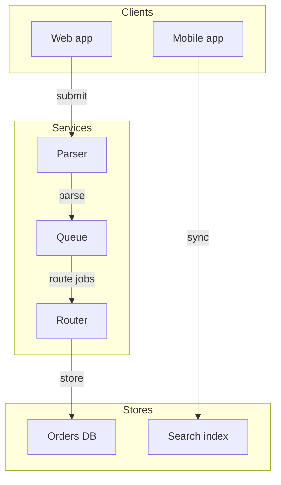

# Proposal: adv5

## Why
Readers cannot tell which branch a label belongs to.

## What
- Draw the routing fixture | refs: R-1 | verify: page renders without fallback

**Not in this change**: nothing else.

## How

- Choice: renderer only

## Risk
- none
