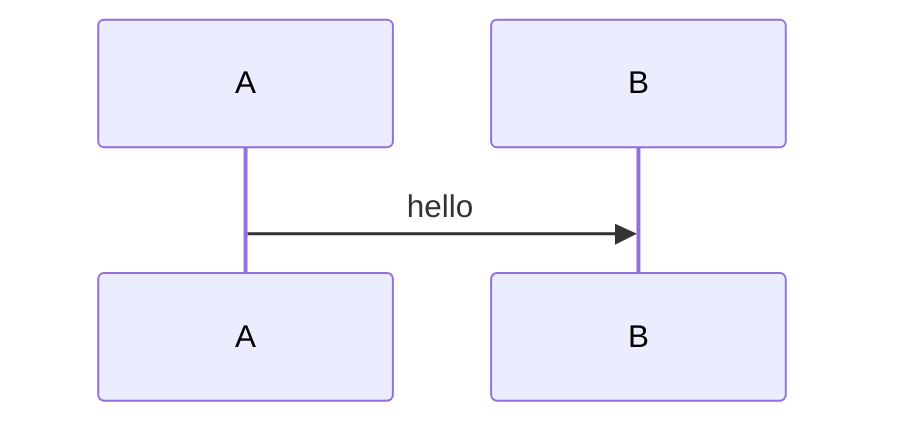

# Proposal: badflow

## Why
The key-flow block below is a sequence diagram, which the offline renderer does not take.

## What
1. **Something** | refs: R-1 | verify: it works

## How

## Risk
- none
