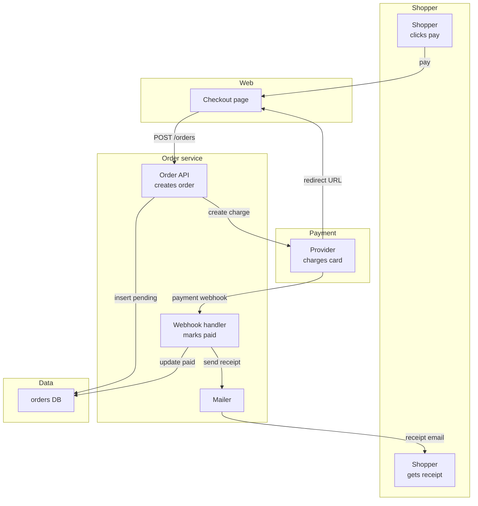

# Proposal: checkout

## Why
Paid orders stay pending until someone refreshes; receipts go out late.

## What
- Mark orders paid from the payment webhook and send the receipt | refs: R-1 | verify: page renders without fallback

**Not in this change**: nothing else.

## How

- Choice: renderer only

## Risk
- none
