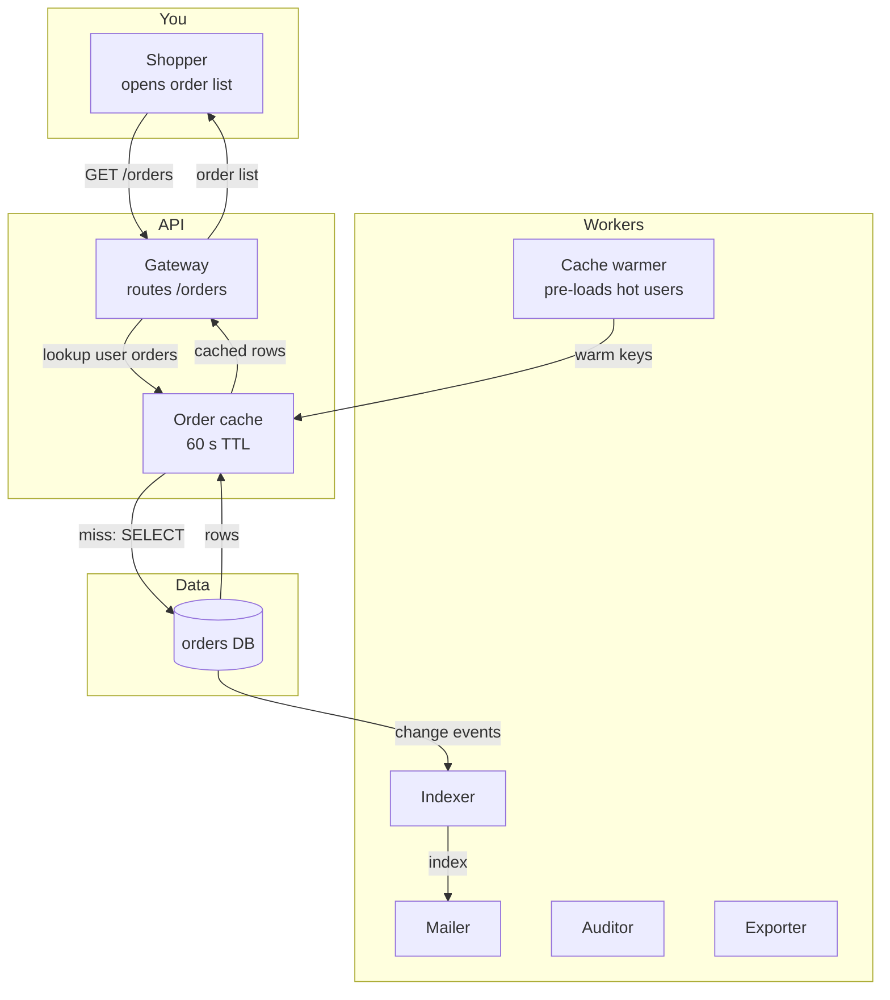

# Proposal: cache-orders

## Why
Order list loads slowly on every visit; the DB is hit for each page view.

## What
- Add a read-through cache in front of the order query | refs: R-1 | verify: second `GET /orders` within 60 s issues no SQL (query log)
- Invalidate on order write | refs: R-2 | verify: after `POST /orders` the next GET returns the new order
- Expose cache hit ratio at `/metrics` | refs: R-1 | verify: `curl /metrics` shows `orders_cache_hit_ratio`

**Not in this change**: cache for other entities; distributed cache cluster.

## How

- Choice: read-through cache in process (not Redis) — one instance, no extra ops
- Invalidation on write path, TTL 60 s as a safety net

## Risk
- Stale reads up to 60 s if an invalidation is missed; mitigation: TTL
- Rollback: remove the cache wrapper; no data migration
