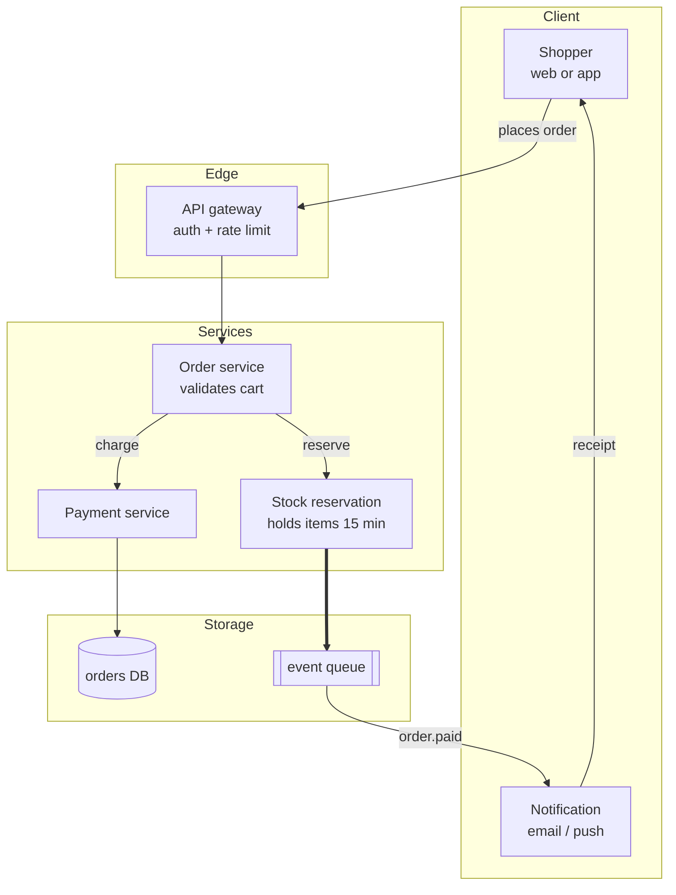
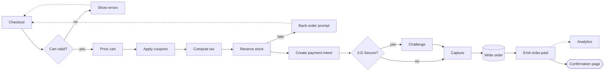
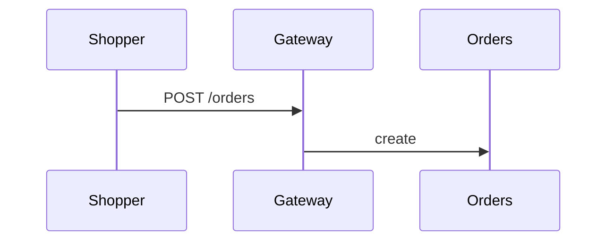

# Design: order-pipeline

## Architecture

Reads go through the gateway; every write lands in the orders database.

## Interfaces

### HTTP
- **Create order**: `POST /api/orders` with the cart id; returns `201` and the order id
- **Get order**: `GET /api/orders/{id}` returns status, totals and lines
- Webhook: `POST /hooks/payment` from the payment provider, signed
  - retries with exponential backoff

### Events
- `order.paid` → stock reservation becomes a sale; notification sent

## Key Decisions

**Reserve stock before payment**
- Problem: two shoppers can pay for the last item at the same time.
- Solution: hold the item for 15 minutes when checkout starts.
- Cost: abandoned checkouts lock stock until the hold expires.
- Why not the alternatives: reserving after payment needs refunds for oversold items.

**Queue between services**
- Problem: a slow notification provider blocks order confirmation.
- Solution: publish `order.paid` to a queue and notify asynchronously.
- Cost: one more piece of infrastructure to operate.

## Migration / Compatibility
- **Database**: add `reserved_until` to `stock_items`; backfill null
- **API**: `GET /api/orders/{id}` gains a `reservation` field; old clients ignore it
- Feature flag `reserve-before-pay` defaults off for one release
