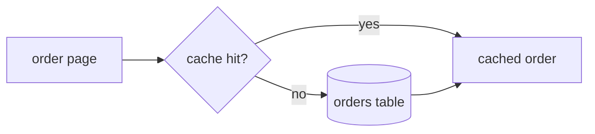

# Design: order-cache

## Architecture

Reads go through the cache; writes go to the table and invalidate the key.

## Interfaces

### Cache client
- Location: `src/cache/orderCache.ts`
- Call: `getOrder(tenant, id)` returns the order or loads it
  - miss → load from the table, store with TTL
- **Invalidate**: `invalidate(tenant, id)` on every write

| op | latency budget |
|---|---|
| hit | 2 ms |
| miss | 30 ms |

### Events
- `order.updated` → invalidate the key

## Key Decisions

**Write-through invalidation**
- Problem: stale status after payment.
- Solution: invalidate on write.
