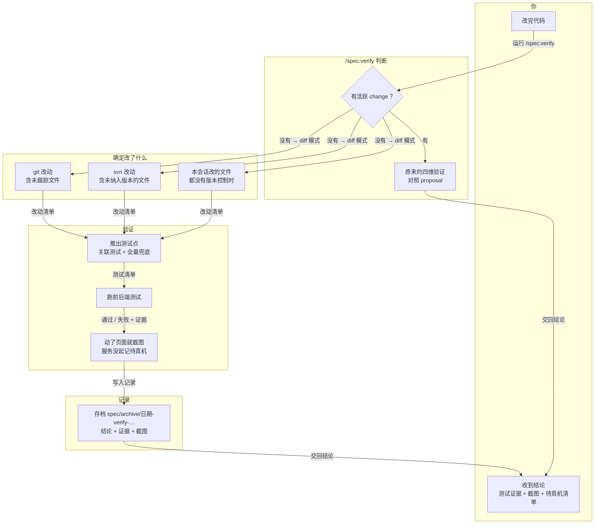

# Proposal: verify-adhoc-diff

## Why

用户常常不走 spec 直接改代码，但仍然希望 `/spec:verify` 能根据对话上下文或 git/svn diff 找出该测的点，跑前后端测试，并收录截图证据（R-1、R-2）。现在 verify 和 spec-verifier 的检查清单、diff 范围、账本位置都绑定在 change 目录上，没有 change 时行为未定义；svn 完全不支持。

## What

1. **diff 模式入口** | refs: R-1 | verify: 在没有任何活跃 change 的 git 夹具里，裸 `/spec:verify` 进入 diff 模式；在有 2 个活跃 change 且无指针的夹具里，它列出这两个 change 并询问，diff 模式是选项之一，不会被静默选中；`--diff [range]` 出现在两个宿主的参数表里，Codex 侧不再写"本宿主无参数"
2. **范围识别：git / svn / 本会话改动** | refs: R-1 | verify: git 夹具（一个修改文件 + 一个未跟踪文件，无 spec/changes/）生成的记录里，范围行同时列出这两个文件；svn 夹具（`svnadmin create` + `file://` 检出，含一个 `?` 文件）的范围行列出该文件，externals 标为范围外；无 VCS 目录下，范围取本会话改过的文件，并在范围行声明"会话外的改动不可见"；机器上没有 svn 时，svn 夹具在 Evidence 记为 `not run: svn not installed`
3. **意图锚与测试点推导** | refs: R-1, R-2 | verify: git 夹具含一个 jest 项目：被改文件对应的测试通过 `--findRelatedTests` 被选中并实际运行，Evidence 带命令和退出码；随后跑一次全量；运行器若配置为跳过测试，记录里写出该配置；无意图来源时，记录写 `Completeness not assessed — no intent source`，并仍给出 Correctness 结论
4. **截图独立成行** | refs: R-2 | verify: 改动了页面文件、应用没在跑的夹具，其记录含 `screens: pending live check — <页面清单>`，不依赖 Completeness 维度；应用在跑时，截图落到记录目录的 screens/ 并在 screens.md 里建行
5. **记录落在 `spec/archive/<date>-verify-<slug>/`，执行规则只写一处** | refs: R-2 | verify: 记录目录名带 `-verify-`，重名加计数后缀，账本含 `mode: diff`、范围行、意图来源行；两套夹具各有同名用例 `verify-record-only-gates-unchanged`（只有该记录时，闸门行为与空项目一致）；执行者规则在 skill.md § Shared Principles 只出现一次，ship.md 与 verify.md 改为引用它（grep 规则原文，全仓库只有 1 处）；变更文件恰好是某个未 ship 的 fix 批次时，输出建议改用 `/spec:ship`

**Not in this change**：hg/perforce；CI 集成；diff 模式自动提交或归档 change；ship 的行为（只把它的执行者规则原文换成引用）。

## How

- 触发：只有零活跃 change 时自动进入 diff 模式；多个活跃且无指针时，沿用 archive 的"列出来问"，diff 模式作为选项之一；`--diff` 在任何情况下都强制进入（DEC-1，r0 修订）
- 范围：git 用 `diff HEAD` 加未跟踪文件；svn 用 `status` 加 `diff`/`-r N:M`，判断工作副本看 stdout 是否为非空路径，不依赖退出码；都没有时用本会话改过的文件，仍为空才问路径（DEC-2，r0 修订）
- 意图：用户原话 → 区间提交信息 → 无；无意图时声明 Completeness 未评估，不拿 diff 自证（DEC-3）。测试点：运行器原生关联选择 → 命名约定 → 全量兜底一次，先做运行器真实性检查（DEC-4）；工作检查沿用 apply 的三级顺序
- 执行者规则和"无 proposal 时的审计契约"写进 skill.md 一处；spec-verifier 增加一个启动分支："没有 proposal 时，由派遣简报提供声明清单和范围"，ship 与 diff 模式共用（DEC-5，r0 修订）。记录放 spec/archive/ 下，沿用 ship 的命名规则，不新建顶层目录（DEC-6，r0 修订）；截图单独成行（DEC-7，r0 修订）；只审计不归档，与 fix 批次重合时让给 ship（DEC-8）
- 落地步骤（compat r0）：verify.md 中每处 `spec/changes/<name>/verify.md` 补上"（diff 模式：spec/archive/<date>-verify-<slug>/verify.md）"，包括描述、Codex 块和"不做什么"；README 中英文的 verify 行与产物树、CLAUDE.md、AGENTS.md、codex/README.md 同步；`/spec:view` 接受记录目录，由 artifact-html-views 提供

## Risk

- 共享文件：verify.md 参数表与 artifact-html-views 的 `--view` 同改；skill.md 与另两个 change 同改；ship.md 只换一段引用；缓解：依次 apply，每次先 regenerate + --check
- 弱模型在本会话自己写了改动后仍"直接审"（自审盲区）；缓解：说不清是否写过时一律派 spec-verifier
- 推导的测试点会漏掉动态 import、反射调用；缓解：全量兜底一次，跑不了全量时在 Evidence 写 `not run: full suite — <原因>`
- spec/archive/ 里不再只有已关闭的 change 和 fix 批次；缓解：目录名中的 `-verify-` 可以区分，status 本来就跳过 archive
- 回滚：删除 diff 模式段、`--diff` 参数与 spec-verifier 新分支，ship.md 的引用换回原文；已有记录是惰性文件

<!-- APPROVED: 2026-11-05 11:48 -->
